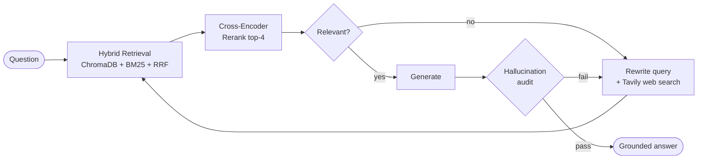

<!-- ═══════════════════════════════════════════════════════════
     Rahul Kumar Pramanik · profile README
     Concept: the README is a "Model Card" — because that's how an ML engineer introduces himself.
     ═══════════════════════════════════════════════════════════ -->

<div align="center">


<a href="https://git.io/typing-svg">
  
</a>

<br/>




[](mailto:Rahulkrpramanik@gmail.com)
[](https://www.linkedin.com/in/rahul-pramanik-284908225/)
[](https://elrath017.pythonanywhere.com/)

</div>

---

## 🧾 Model Card: `rahul-v1.0`

| | |
|---|---|
| **Model type** | Applied AI & Data Science Engineer |
| **Base architecture** | MCA, BIT Mesra (CGPA 7.88) · BCA (CGPA 8.49) |
| **Fine-tuned on** | Agentic RAG · Imbalanced classification · MLOps · Analytics dashboards |
| **Inference latency** | 2–5 ms (when it's an API); a few seconds (when it's me, with coffee) |
| **Intended use** | GenAI products, ML pipelines, explainable decision systems |
| **Deployment target** | 🌍 Remote, India-based, open to hybrid |
| **Status** | 🟢 Available. Currently **open to work** |

```python
class Rahul:
    role      = ["AI Engineer", "Data Scientist"]      # equally into both
    believes  = "A model nobody can explain is a model nobody should ship."
    stack     = {
        "genai": ["LangGraph", "LangChain", "ChromaDB", "FAISS", "Ragas"],
        "ml":    ["XGBoost", "Scikit-learn", "SHAP", "SMOTE", "Evidently AI"],
        "ship":  ["FastAPI", "Docker", "Streamlit", "Git", "Linux"],
        "data":  ["SQL", "Pandas", "NumPy", "Power BI (DAX)"],
    }

    def next_move(self):
        return "Join a team that ships AI to real users."
```

---

## 🚀 Featured Projects

### 🧠 [Autonomous Agentic RAG Engine](https://github.com/elrath017/Agentic-rag-System)
> A RAG system that doesn't just answer. It grades its own retrieval, rewrites bad queries, falls back to the web, and audits the final answer for hallucinations.



**What's inside:** LangGraph cyclic state machine · dense + sparse retrieval fused with Reciprocal Rank Fusion · LLM cross-encoder reranking · PDF/TXT/URL ingestion with boilerplate stripping · Ragas evaluation (Faithfulness, Answer Relevance, Context Recall) · async FastAPI + Streamlit dashboard.

`LangGraph` `ChromaDB` `BM25Okapi` `Ragas` `FastAPI` `Streamlit`

---

### 🛡️ Real-Time Fraud Detection API with Explainable AI

> Fraud is **0.17%** of transactions. Accuracy is a lie here, so I optimized for money.

<div align="center">

| 🎯 PR-AUC | 🔍 Recall | ⚡ Latency | 💰 Loss reduction |
|:---:|:---:|:---:|:---:|
| **0.9978** | **97.56%** <br/><sub>40 / 41 frauds caught</sub> | **2–5 ms** <br/><sub>vs. 40 ms SLA</sub> | **95.69%** <br/><sub>vs. passive baseline</sub> |

</div>

- **Cost-matrix decision engine** (`FN = 10 × FP`) tunes thresholds to business loss, not just metrics
- **TreeSHAP** gives sub-3 ms feature attribution plus plain-English risk reason codes
- **Evidently AI + KS tests** watch streaming feature drift in production

`XGBoost` `SHAP` `FastAPI` `Evidently AI` `Docker`

---

### 📊 [Financial Credit Risk & Loan Portfolio Dashboard](https://github.com/elrath017/Loan-default-risk-analysis)

Multi-page Power BI dashboard over **50,000+ loan records**: star-schema modeling in Power Query, **25+ DAX measures** (default probability, LGD, delinquent balances) and cohort-level risk segmentation.

<div align="center"></div>

`Power BI` `DAX` `Power Query` `Star Schema`

<details>
<summary><b>🗂️ More projects: earlier experiments that got me here</b></summary>
<br/>

| Project | What it does | Stack |
|---|---|---|
| 📰 **GenAI News & Document Query Engine** | RAG semantic search over documents and news, with a **local** Llama 3.2 3B served through the LM Studio API and a Streamlit front end | `LangChain` `FAISS` `Llama 3.2` `Streamlit` |
| 🖼️ **Image Caption Generator** | Image captioning with VGG16 feature extraction + LSTM sequence generation, multilingual captions, React front end | `TensorFlow` `VGG16` `LSTM` `React` |
| 🎬 **Movie Recommendation System** | Content-based filtering with cosine similarity over vectorized movie metadata, searchable Streamlit UI | `Scikit-learn` `Pandas` `Streamlit` |
| 📺 **Netflix Data Analysis** | EDA and reporting pipeline surfacing trends across movies and TV shows | `Pandas` `NumPy` `Matplotlib` |
| 💳 **Loan Default Risk Dashboard** | Early Power BI version with YoY analysis, credit-score bins, income brackets and demographic insights | `Power BI` `DAX` |

</details>

---

## 🧰 Toolbox

<div align="center">


</div>

| Layer | Tools |
|---|---|
| 🤖 **Generative AI & NLP** | LangGraph · LangChain · Hybrid Search · RRF · Cross-Encoder Reranking · ChromaDB · FAISS · Ragas · Prompt Engineering |
| 📈 **ML & Data Science** | XGBoost · Scikit-learn · SMOTE / `scale_pos_weight` · Feature Engineering · TreeSHAP · KS Testing · Cost-Matrix Optimization |
| ⚙️ **Backend & MLOps** | FastAPI · Uvicorn · Docker · DevContainers · Evidently AI · Streamlit · Flask |
| 🗄️ **Data & Languages** | Python · C++ · JavaScript · SQL (PostgreSQL, MySQL) · Pandas · NumPy · Matplotlib · TensorFlow · Power BI |

---

## 📡 GitHub Telemetry

<div align="center">


</div>

---

## 🔭 Currently

- 🧪 Building a **hybrid DS + AI project** that connects classical ML with LLM agents
- 🌐 Evolving my **[portfolio site](https://elrath017.pythonanywhere.com/)**, with an LLM chatbot that can talk about my projects
- 🌱 Learning: **AI agents & LangGraph** · **LLM fine-tuning** · **MLOps & deployment** · advanced GenAI apps · advanced Power BI
- 🤝 Looking for a **remote AI / Data Science role** where I can ship, measure, and explain

## 💬 Let's talk

🌐 **Portfolio:** [elrath017.pythonanywhere.com](https://elrath017.pythonanywhere.com/)

If you're hiring, building something with agents or RAG, or want to compare notes on imbalanced data, I'd love to hear from you.

> 💡 *Fun fact: I like combining AI, analytics and visualization to build things that are intelligent **and** actually useful.*

<div align="center">

[](mailto:Rahulkrpramanik@gmail.com)


</div>
