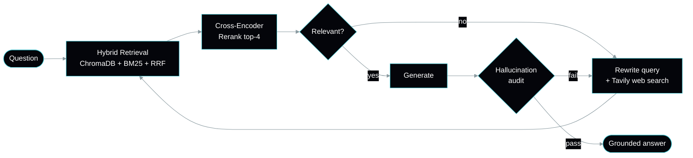

<!-- ═══════════════════════════════════════════════════════════
     Rahul Kumar Pramanik · profile README
     Visual language: black canvas · hairline white networks · cyan data tags
     Concept: the README is a "Model Card", the way an ML engineer introduces himself.
     ═══════════════════════════════════════════════════════════ -->

<div align="center">



<a href="https://git.io/typing-svg">
  
</a>

<br/><br/>


[](mailto:Rahulkrpramanik@gmail.com)
[](https://www.linkedin.com/in/rahul-pramanik-284908225/)
[](https://elrath017.pythonanywhere.com/)

</div>


### `// 01` &nbsp;MODEL CARD · `rahul-v1.0`

| FIELD | VALUE |
|---|---|
| **MODEL TYPE** | Applied AI & Data Science Engineer |
| **BASE ARCHITECTURE** | MCA, BIT Mesra (CGPA 7.88) · BCA (CGPA 8.49) |
| **FINE-TUNED ON** | Agentic RAG · Imbalanced classification · MLOps · Analytics dashboards |
| **INFERENCE LATENCY** | 2–5 ms (when it's an API); a few seconds (when it's me, with coffee) |
| **INTENDED USE** | GenAI products, ML pipelines, explainable decision systems |
| **DEPLOYMENT TARGET** | Remote, India-based, open to hybrid |
| **STATUS** | `AVAILABLE` · currently open to work |

```python
class Rahul:
    role      = ["AI Engineer", "Data Scientist"]      # equally into both
    believes  = "A model nobody can explain is a model nobody should ship."
    stack     = {
        "genai": ["LangGraph", "LangChain", "ChromaDB", "FAISS", "Ragas"],
        "ml":    ["XGBoost", "Scikit-learn", "SHAP", "SMOTE", "Evidently AI"],
        "ship":  ["FastAPI", "Docker", "Streamlit", "Git", "Linux"],
        "data":  ["SQL", "Pandas", "NumPy", "Power BI (DAX)"],
    }

    def next_move(self):
        return "Join a team that ships AI to real users."
```


### `// 02` &nbsp;FEATURED PROJECTS

#### `SR - 7832` &nbsp;[Autonomous Agentic RAG Engine](https://github.com/elrath017/Agentic-rag-System)
> A RAG system that doesn't just answer. It grades its own retrieval, rewrites bad queries, falls back to the web, and audits the final answer for hallucinations.



**What's inside:** LangGraph cyclic state machine · dense + sparse retrieval fused with Reciprocal Rank Fusion · LLM cross-encoder reranking · PDF/TXT/URL ingestion with boilerplate stripping · Ragas evaluation (Faithfulness, Answer Relevance, Context Recall) · async FastAPI + Streamlit dashboard.

`LangGraph` `ChromaDB` `BM25Okapi` `Ragas` `FastAPI` `Streamlit`

<br/>

#### `P - 8931` &nbsp;Real-Time Fraud Detection API with Explainable AI
> Fraud is **0.17%** of transactions. Accuracy is a lie here, so I optimized for money.

<div align="center">

| PR-AUC | RECALL | LATENCY | LOSS REDUCTION |
|:---:|:---:|:---:|:---:|
| **0.9978** | **97.56%** <br/><sub>40 / 41 frauds caught</sub> | **2–5 ms** <br/><sub>vs. 40 ms SLA</sub> | **95.69%** <br/><sub>vs. passive baseline</sub> |

</div>

- **Cost-matrix decision engine** (`FN = 10 × FP`) tunes thresholds to business loss, not just metrics
- **TreeSHAP** gives sub-3 ms feature attribution plus plain-English risk reason codes
- **Evidently AI + KS tests** watch streaming feature drift in production

`XGBoost` `SHAP` `FastAPI` `Evidently AI` `Docker`

<br/>

#### `VA - 2904` &nbsp;[Financial Credit Risk & Loan Portfolio Dashboard](https://github.com/elrath017/Loan-default-risk-analysis)

Multi-page Power BI dashboard over **50,000+ loan records**: star-schema modeling in Power Query, **25+ DAX measures** (default probability, LGD, delinquent balances) and cohort-level risk segmentation.

<div align="center"></div>

`Power BI` `DAX` `Power Query` `Star Schema`

<details>
<summary><b><code>+ MORE PROJECTS</code> · earlier experiments that got me here</b></summary>
<br/>

| PROJECT | WHAT IT DOES | STACK |
|---|---|---|
| **GenAI News & Document Query Engine** | RAG semantic search over documents and news, with a **local** Llama 3.2 3B served through the LM Studio API and a Streamlit front end | `LangChain` `FAISS` `Llama 3.2` `Streamlit` |
| **Image Caption Generator** | Image captioning with VGG16 feature extraction + LSTM sequence generation, multilingual captions, React front end | `TensorFlow` `VGG16` `LSTM` `React` |
| **Movie Recommendation System** | Content-based filtering with cosine similarity over vectorized movie metadata, searchable Streamlit UI | `Scikit-learn` `Pandas` `Streamlit` |
| **Netflix Data Analysis** | EDA and reporting pipeline surfacing trends across movies and TV shows | `Pandas` `NumPy` `Matplotlib` |
| **Loan Default Risk Dashboard** | Early Power BI version with YoY analysis, credit-score bins, income brackets and demographic insights | `Power BI` `DAX` |

</details>


### `// 03` &nbsp;TOOLBOX

<div align="center">


</div>

| LAYER | TOOLS |
|---|---|
| **GENERATIVE AI & NLP** | LangGraph · LangChain · Hybrid Search · RRF · Cross-Encoder Reranking · ChromaDB · FAISS · Ragas · Prompt Engineering |
| **ML & DATA SCIENCE** | XGBoost · Scikit-learn · SMOTE / `scale_pos_weight` · Feature Engineering · TreeSHAP · KS Testing · Cost-Matrix Optimization |
| **BACKEND & MLOPS** | FastAPI · Uvicorn · Docker · DevContainers · Evidently AI · Streamlit · Flask |
| **DATA & LANGUAGES** | Python · C++ · JavaScript · SQL (PostgreSQL, MySQL) · Pandas · NumPy · Matplotlib · TensorFlow · Power BI |


### `// 04` &nbsp;GITHUB TELEMETRY

<div align="center">


</div>


### `// 05` &nbsp;CURRENTLY

- **BUILDING** a hybrid DS + AI project that connects classical ML with LLM agents
- **EVOLVING** my [portfolio site](https://elrath017.pythonanywhere.com/), with an LLM chatbot that can talk about my projects
- **LEARNING** AI agents & LangGraph · LLM fine-tuning · MLOps & deployment · advanced GenAI apps · advanced Power BI
- **LOOKING FOR** a remote AI / Data Science role where I can ship, measure, and explain

### `// 06` &nbsp;LET'S TALK

If you're hiring, building something with agents or RAG, or want to compare notes on imbalanced data, I'd love to hear from you.

> *Fun fact: I like combining AI, analytics and visualization to build things that are intelligent **and** actually useful.*

<div align="center">

[](mailto:Rahulkrpramanik@gmail.com)



</div>